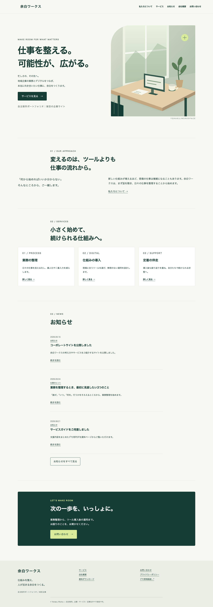
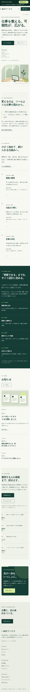
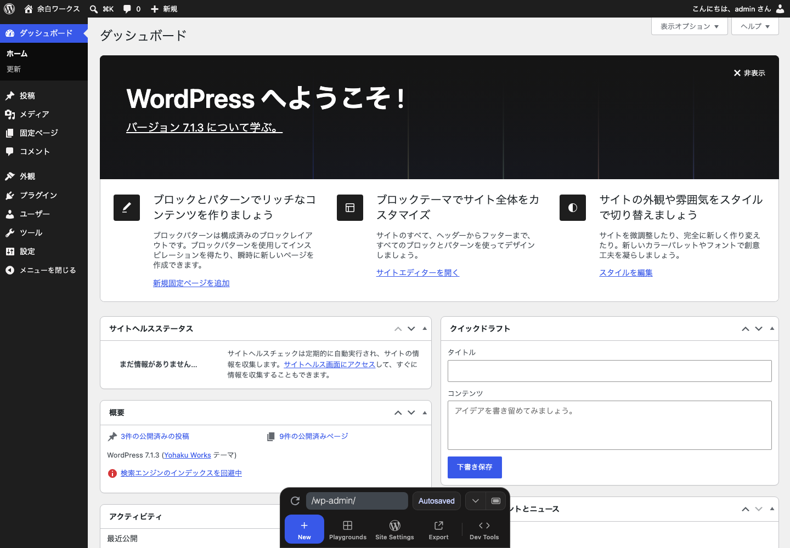

# Yohaku Works — WordPress Corporate Portfolio

架空企業「余白ワークス」のコーポレートサイトを題材にした、**WordPressサイト制作の自主制作ポートフォリオ**です。

見た目を作るだけではなく、実際のWordPressと同じように、**管理画面から文章・画像・お知らせ・ナビゲーションを更新できること**まで含めて制作しています。公開サイトと管理画面はどちらもブラウザだけで試せます。

> このサイトは自主制作であり、実在企業の受託実績・顧客実績ではありません。

## まず試す

[**公開サイトを見る →**](https://playground.wordpress.net/?blueprint-url=https%3A%2F%2Fraw.githubusercontent.com%2Frew552%2Fwordpress-corporate-portfolio01%2Fmain%2Fdemo%2Flaunch-blueprint.json)　　[**WordPress管理画面を試す ↗**](https://playground.wordpress.net/?blueprint-url=https%3A%2F%2Fraw.githubusercontent.com%2Frew552%2Fwordpress-corporate-portfolio01%2Fmain%2Fdemo%2Fadmin-launch-blueprint.json)

リンクを開くと **WordPress Playground** がブラウザ上に一時的なWordPress環境を作ります。サーバー契約、ローカル環境構築、アカウント作成は不要です。管理画面側はデモ用の管理者として自動ログインします。



## このポートフォリオで見てほしいこと

このリポジトリでは、主に次の4点を確認できます。

1. **企業サイトとしてのデザインと情報設計**  
   TOP、サービス、会社概要、お知らせ、お問い合わせなど、一般的なコーポレートサイトに必要なページを一通り制作しています。

2. **WordPressをCMSとして運用できる構成**  
   ページの文章や画像を管理画面から編集でき、お知らせを投稿すると一覧へ自動反映されます。テーマファイルを書き換えなくても、日常的な更新を行える設計です。

3. **PC・タブレット・スマートフォンへの対応**  
   画面幅ごとのレイアウトだけでなく、日本語の読みやすさ、キーボード操作、フォーカス表示、見出し構造なども確認しています。

4. **公開リポジトリとして説明できる実装**  
   テーマ、デモ用機能、Playground初期化処理、生成処理を分離し、GitHub上のコード自体もレビュー対象になることを意識して整理しています。

| 公開サイト | WordPress管理画面 |
|---|---|
|  |  |

## 管理画面で試せること

管理画面は閲覧用のスクリーンショットではなく、実際に操作できます。

- **TOPページを編集する** — 文章やセクションをブロックエディターで変更
- **お知らせを追加する** — 新しい投稿を公開し、TOP・一覧への自動反映を確認
- **画像を差し替える** — メディアライブラリから画像を追加・置換
- **ナビゲーションを変更する** — サイト上部のメニューを編集
- **サイト全体を確認する** — ヘッダー、フッター、共通スタイルをSite Editorから確認

公開サイト上部の **PORTFOLIO DEMO** バーからも管理画面へ移動できます。

Playgroundは使い捨てのデモ環境です。操作内容がこのGitHubリポジトリへ書き戻されることはありません。また、お問い合わせフォームは入力チェックと完了表示のデモのみで、**メール送信・データ保存・外部通信は行いません**。

## 制作したページ・機能

| ページ | パス | 内容 |
|---|---|---|
| TOP | `/` | 企業紹介、サービス、事例、お知らせ、問い合わせ導線 |
| 私たちについて | `/about/` | 理念、考え方、価値観 |
| サービス | `/services/` | 3つの支援内容と進め方 |
| 会社概要 | `/company/` | 架空企業の基本情報 |
| お知らせ | `/news/` | WordPress投稿の一覧、分類、ページ送り |
| お知らせ詳細 | `/site-open/` 等 | 本文、カテゴリ、アイキャッチ、前後の記事 |
| お問い合わせ | `/contact/` | 必須入力・形式チェック・同意・完了表示を含むデモフォーム |
| 資料 | `/resources/` | PDF資料と保護ページへの導線 |
| 保護ページ | `/partners/` | WordPress標準のパスワード保護 |
| プライバシー | `/privacy/` | デモにおけるデータの取り扱い |
| その他 | 404 / 検索 / カテゴリ | サイト全体と統一した表示 |

## 制作方針

想定したのは、地域の中小企業の業務改善を支援する架空企業です。

WordPress案件で重要なのは、制作時の見栄えだけでなく、公開後に担当者が自分で更新できることだと考え、**外部のページビルダーへ強く依存せず、WordPress標準機能を中心に構成**しました。

具体的には以下の方針です。

- TOPページを含む主要コンテンツを管理画面から編集可能にする
- お知らせにはWordPress標準の「投稿」を使い、独自管理画面を増やしすぎない
- ヘッダー、フッター、ナビゲーションもWordPress標準の編集機能を利用する
- テーマは見た目と表示を担当し、デモ専用機能は専用プラグインへ分離する
- 外部フォント、外部画像サービス、アクセス解析に依存しない
- 架空の成果数値、顧客ロゴ、制作実績を使用しない

## WordPressで更新できる箇所

| 更新対象 | 管理画面での操作 |
|---|---|
| TOPの文章・サービス紹介 | 固定ページ「ホーム」を編集 |
| 新しいお知らせ | 「投稿」から追加 |
| お知らせ一覧 | 投稿内容から自動生成 |
| 会社情報・サービス本文 | 各固定ページを編集 |
| 画像 | 画像ブロックまたはメディアライブラリから置換 |
| サイト名 | 「設定」またはSite Editorから変更 |
| ナビゲーション | Site EditorのNavigationから変更 |
| ヘッダー・フッター | Site Editorから変更 |
| 配色・書体 | Site Editorのスタイル / `theme.json` で管理 |
| PDF | メディアへ追加し、資料ページのリンクを変更 |
| 保護設定 | 固定ページの公開設定からパスワードを設定 |

## 技術構成

WordPressの **Block Theme** と標準ブロックを中心に構成しています。

- Block Theme / `theme.json` v3
- Gutenberg標準ブロック
- WordPress標準の固定ページ・投稿
- Query Loopによる投稿一覧
- Navigation / Site Editor
- WordPress Playground / Blueprint
- Playwright + axeによるブラウザ・アクセシビリティ確認

TOPページの内容はテーマファイルへ直接書き込まず、固定ページのブロックとして保存しています。そのため、文章・カード・画像・ボタンなどをWordPress管理画面から編集できます。

お知らせも独自投稿タイプを追加せず、WordPress標準の「投稿」を利用しています。問い合わせフォームのデモ挙動、デモ案内バー、管理画面のガイドのみをPlayground用プラグインへ分離し、テーマ本体はサイト表示に集中させています。

## コードを見る場合

人が主に読むことを想定しているソースは次の4箇所です。

```text
theme/yohaku/             WordPressテーマ
plugins/yohaku-demo-form/ Playground専用のデモ機能
demo/                     初期コンテンツとWordPress初期化処理
scripts/                  ビルド・検証・ブラウザQA
```

詳しい責務分担、セキュリティ上の考え方、CSSレイヤーの役割は [docs/code-quality.md](docs/code-quality.md) にまとめています。

### 生成ファイルについて

以下のファイルは、Playgroundでデモを起動するために `npm run build` が自動生成します。

- `blueprint.json`
- `demo/launch-blueprint.json`
- `demo/admin-launch-blueprint.json`
- `demo/launch.html`
- `README.md`

特にLaunch Blueprintには圧縮済みデータが含まれるため、巨大なbase64文字列を人が直接編集する設計にはしていません。READMEの編集元は `README.template.md` です。

## 品質確認

公開前の確認を自動化しています。

### 静的チェック

```sh
npm run audit
npm run validate
```

`npm run audit` では、デバッグコード、意図しない外部通信、危険なDOM操作、独自リクエスト処理、秘密情報らしい文字列などが公開ソースへ混入していないかを確認します。

`npm run validate` では、上記に加えてPlayground Blueprint、デモURL、生成ファイルとソースコードの整合性などを確認します。

### ブラウザQA

```sh
npm run quality
```

ローカルのWordPress Playgroundを起動し、以下を自動確認します。

- Chromium / Firefox / WebKit
- 375 / 390 / 768 / 1024 / 1440px の画面幅
- 主要ページ・404ページ
- 横スクロールや見出し構造
- axeによるWCAG A/AAのserious / critical違反
- 主要画面のビジュアルリグレッション

詳細な確認項目は [docs/test-checklist.md](docs/test-checklist.md) を参照してください。

## ローカルで動かす

必要なのは Node.js **24.18.0以上** とnpmです。PHP、MySQL、Dockerを別途インストールする必要はありません。

```sh
npm ci
npm run build
npm run validate
npm start
```

ブラウザQAも実行する場合は、Playwrightのブラウザをインストールします。

```sh
npx playwright install chromium firefox webkit
npm run quality
```

テーマやデモコンテンツを変更した場合は `npm run build` を実行してください。Blueprint、デモ起動用ファイル、READMEが再生成されます。

## リポジトリ構成

```text
.
├── theme/yohaku/             # 自作WordPressテーマ
├── plugins/yohaku-demo-form/ # Playground専用デモ機能
├── demo/                     # 初期コンテンツ・初期化処理・生成Blueprint
├── scripts/                  # build / audit / validate / browser quality
├── docs/                     # 要件・設計・品質方針・テスト記録
├── screenshots/              # 実際のWordPress画面
├── blueprint.json            # buildで生成
├── README.template.md        # README編集元
└── README.md                 # buildで生成
```

## デモ上の制約

- お問い合わせフォームは実際の問い合わせ送信を行いません。
- Playground内で行った編集は、環境を閉じると失われる場合があります。
- WordPressは `latest` を指定しているため、WordPress更新時には再検証が必要です。
- 実案件へ利用する場合は、実データへの置換、メール送信、スパム対策、バックアップ、ユーザー権限、更新運用などを別途設計する必要があります。
- WebKitによる自動試験はSafari相当エンジンでの回帰確認であり、実機Safariそのものを保証するものではありません。

## ライセンス

GPL-2.0-or-later。テーマ、専用プラグイン、独自ドキュメント、自作図版、同梱PDFに適用します。WordPress / WordPress Playgroundは各プロジェクトのライセンスに従います。
