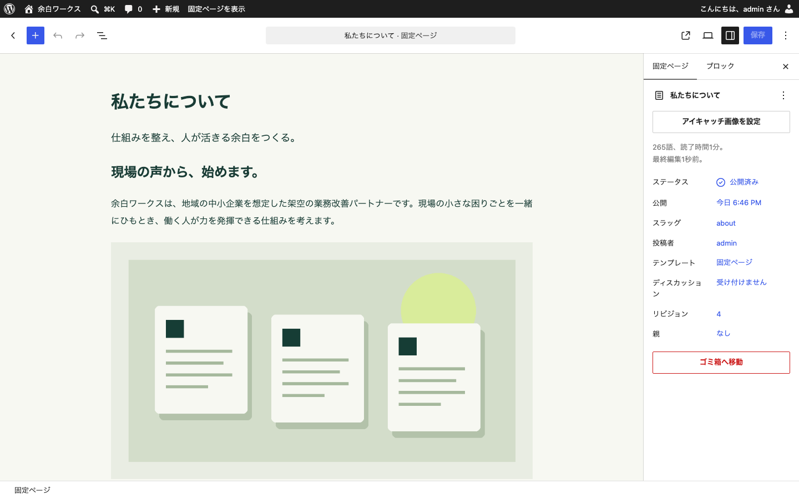

# wordpress-corporate-portfolio01

**余白ワークス — 仕事を整え、人が活きる余白をつくる。**

WordPress案件への応募を想定した自主制作コーポレートサイトです。企業・サービス・記事はすべて架空です。実在企業の受託実績や顧客実績を示すものではありません。

[**Launch in WordPress Playground →**]({{LAUNCH_URL}})

[GitHub上のBlueprintから起動する（短いリンク）](https://playground.wordpress.net/?blueprint-url=https://raw.githubusercontent.com/rew552/wordpress-corporate-portfolio01/main/blueprint.json)

上のリンクで、ブラウザ内にWordPress・テーマ・デモコンテンツを作成し、管理者として自動ログインします。サーバー契約、GitHub Pages、外部APIキーは不要です。初回は実行資産のダウンロードに数十秒〜数分かかります。Chrome / Edge等の現行ブラウザとネット接続をご利用ください。

リンクは自己完結した圧縮版Blueprintを含みます。GitHubのMarkdown変換でもリンクが保持されることを確認しています。リンクを扱えない環境では、[WordPress Playground](https://playground.wordpress.net/) の **New → Write a Blueprint** に [blueprint.json](blueprint.json) の内容を貼り付けて実行してください。ダウンロード後は `demo/launch.html` をブラウザで開く方法も使えます。

## 概要

想定企業は地域の中小企業の業務改善を支援する架空の「余白ワークス株式会社」です。派手な依存構成より、非エンジニアが更新できるWordPress標準機能と保守性を優先しました。

Repository description:

> A WordPress corporate website portfolio showcasing responsive design and common business features.

- Block Theme / `theme.json` v3 / Gutenberg / Playground / Blueprint
- 投稿・カテゴリ・アイキャッチ・固定ページ・Query Loop・Navigationを標準機能で実装
- 外部テーマや外部プラグインは不要。専用デモフォームプラグインのみ同梱
- WordPress本体、実サイトの認証情報、個人情報はGit管理しません

## ページ・機能

| ページ | パス | 内容 |
|---|---|---|
| TOP | `/` | 編集可能なヒーロー、サービス、最新投稿、相談導線 |
| 私たちについて | `/about/` | 理念、画像ブロック、価値観 |
| サービス | `/services/` | 3つの支援内容、進め方 |
| 会社概要 | `/company/` | 架空企業の情報表 |
| お知らせ | `/news/` | 標準投稿一覧、分類、ページ送り、空状態 |
| お知らせ詳細 | `/site-open/` 等 | 本文、カテゴリ、アイキャッチ、前後の記事 |
| お問い合わせ | `/contact/` | ラベル・必須・メール形式・最小文字数・同意・完了表示 |
| 資料 | `/resources/` | 同梱PDF、パスワード保護例への導線 |
| 保護ページ | `/partners/` | WordPress標準のパスワード保護 |
| プライバシー | `/privacy/` | デモ上のデータ取り扱い |
| その他 | 存在しないURLなど | 404、検索、カテゴリ一覧、モバイルナビ |

## デモを試す

1. Launchリンクを開き、起動完了を待ちます。
2. 公開画面の各ページ、スマートフォン幅のナビ、PDFをご確認ください。
3. フッターの「デモ管理画面」から管理画面へ移動します。
4. **投稿 → お知らせ記事 → 編集** で見出し・本文・カテゴリ・アイキャッチを編集し、更新します。
5. **固定ページ → 私たちについて → 編集** で本文や画像を差し替えます。
6. **外観 → エディター** で共通ヘッダー・フッター・色・文字を確認できます。

Playgroundはデモ専用の使い捨て環境です。変更はGitHubのソースに反映されません。再起動・ブラウザの状態により消えることがあるため、残したい変更はPlaygroundのエクスポート機能をご利用ください。

管理画面はBlueprintの `login: true` により自動ログインします。実管理者のパスワードは含めていません。保護ページのパスワード **`yohaku-demo`** は公開デモ専用の無害な値です。

フォームはブラウザ内で入力検証と完了表示だけを行います。メール送信・サーバー保存・LocalStorage保存・外部通信は行いません。テスト値 `デモ 太郎` / `demo@example.com` を使用してください。実際の問い合わせ受付には、送信・保存・スパム対策・運用設計を別途実装する必要があります。

## ローカル確認

Node.js **24.18.0以上** とnpm **11.16.0以上**をご用意ください。PHP・MySQL・Dockerのインストールは不要です。

```sh
npm ci
npm run build
npm run validate
npm start
```

表示された `http://127.0.0.1:9400` を開きます。公式Playground CLIがPHP/WASMとSQLiteでWordPressを実行します。終了は Ctrl+C。初回起動にはネット接続が必要です。WordPressの実行データはリポジトリに含めません。

テーマ・フォーム・初期コンテンツを変更したら `npm run build` でBlueprintとLaunchリンクを再生成し、新しい環境を起動します。起動済み環境への自動反映はありません。READMEは `README.template.md` が編集元です。

## リポジトリ構成

```text
.
├── theme/yohaku/             # 自作Block Theme
│   ├── theme.json            # 配色・文字・幅・余白
│   ├── templates/            # TOP / 固定 / 投稿 / 一覧 / 検索 / 404
│   ├── parts/                # 共通ヘッダー・フッター
│   ├── patterns/             # 共通部品・サービスカード
│   ├── assets/               # CSS・自作図版・デモPDF
│   ├── style.css
│   └── functions.php
├── plugins/yohaku-demo-form/ # 小さな独立したデモフォーム
├── demo/                    # ブロック本文・記事JSON・初期化PHP・起動HTML・圧縮起動版
├── scripts/                 # Blueprint生成・検証
├── blueprint.json           # 生成済み、公開URL未設定でも実行可能
├── docs/                    # 要件・設計・検証記録・公開手順
├── screenshots/             # 実WordPress上の確認画像
├── README.template.md       # README編集元
├── README.md                # Launchリンクを含む生成済みREADME
└── package.json / package-lock.json
```

## CMSでの更新箇所

| 更新対象 | 操作 |
|---|---|
| TOPの文章・サービス紹介 | 固定ページ「ホーム」の各標準ブロックを編集 |
| 新しいお知らせ | 投稿を追加し、カテゴリ・抜粋・アイキャッチを設定 |
| お知らせ一覧 | 投稿データから自動表示。本文の手動更新不要 |
| 会社情報・サービス本文 | 対象の固定ページを編集 |
| 画像 | 画像ブロックの「置換」からメディアを選択・アップロード |
| ロゴ相当のサイト名 | 設定 → 一般、またはサイトエディターのサイトタイトル |
| ナビゲーション | 外観 → エディター → ヘッダーのNavigationブロック |
| 共通フッター | 外観 → エディター → フッター |
| 配色・書体 | サイトエディターのスタイル / `theme.json` |
| PDF | メディアへPDFを追加して資料ページのリンクを置換 |
| 保護設定 | 固定ページの公開状態 → パスワード保護 |

## 設計ポイント

`templates/front-page.html` から固定ページ本文を表示し、TOPをテーマファイルに閉じ込めません。標準ブロックで文章・カード・画像を編集できます。お知らせは標準投稿を使い、CPTは追加していません。フォームの振る舞いはテーマから分離しました。

余白、深いグリーン、オフホワイト、自作のワークスペース図版を軸に、架空の成果数値や顧客ロゴに頼らない信頼感を設計しました。外部フォント・画像サービス・アクセス解析への依存はありません。

`main` / `header` / `footer` / Navigation、WordPressのスキップリンク、見出し階層、フォーカス表示、フォームラベル、完了通知、reduced motionに配慮しています。タイトルはWordPress標準、単一ページの説明文はテーマ、canonicalとサイトマップはWordPress標準を利用します。デモ環境は検索エンジンに出さない `blog_public=0` とし、保護ページの本文を説明文に含めません。

## テスト・スクリーンショット

詳細な実施結果と未実施範囲は [docs/test-checklist.md](docs/test-checklist.md) を参照してください。再現手順と採用判断は [docs/design.md](docs/design.md) に記載しています。




## 公開方法

公開先は [rew552/wordpress-corporate-portfolio01](https://github.com/rew552/wordpress-corporate-portfolio01) です。GitHub Pagesの設定は不要です。自己完結したLaunchリンクは所有者名・ブランチ名に依存しません。短い `?blueprint-url=` リンクにしたい場合は [公開手順](docs/publishing.md) に従います。

## 制約と改善候補

- デモフォームは実際の問い合わせ受付を行いません。
- パスワード保護はWordPress標準機能の確認用で、機密情報を置きません。
- 地図、実在住所、実在顧客、成果実績、電話番号は架空企業のため掲載していません。
- `preferredVersions.wp: latest` は現在の安定版を使います。将来の互換性は更新時に再検証してください。
- 自動投入した初期本文と、CMS上の編集内容は別です。編集結果を採用する場合はソース側へ反映してください。
- 実案件への転用時は、実情報への置換、送信基盤、運用・バックアップ・セキュリティ更新、対象ブラウザでの追加確認が必要です。
- 将来的にはOGP画像、構造化データ、フォームの本番対応、編集者向け権限・承認フローを検討できます。

## ライセンス

GPL-2.0-or-later。テーマ・専用プラグイン・独自ドキュメント・自作図版・同梱PDFに適用します。WordPress / Playgroundは各プロジェクトのライセンスに従います。
